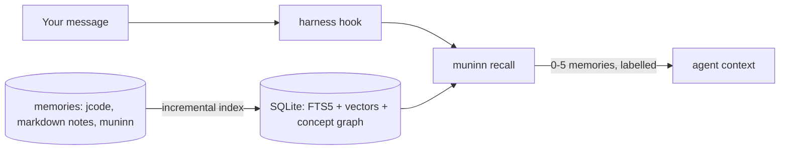

# muninn

**Local-first memory recall for AI coding agents.** muninn indexes your memories
on your own machine and injects the few that matter into the agent's context,
automatically, before it answers. No account, no API key, no remote service.

It works with **jcode**, **Claude Code** and **Codex** through their hooks, with
any MCP client through `muninn mcp`, and it has a local **web UI** and a **TUI**.
One static binary for macOS, Linux and Windows (arm64 and amd64).

> Muninn is Odin's raven of memory: it flies out every morning and brings back
> what matters.

## How it works



Every source is indexed **incrementally** and **content-addressed**, so a small
change never redoes everything:

- A source whose (mtime, size) is unchanged is skipped with a single `stat`.
- Inside a changed source, each unit is identified by a hash of its text and
  metadata. Unchanged units are not touched at all.
- Embeddings are keyed by `(content_hash, pipeline_hash)`. Identical text shares
  one vector, and changing the embedding recipe invalidates exactly the vectors
  whose identity changed.
- Concept communities are updated with frontier-restricted **DF-Louvain**: only
  the neighbourhood of what changed is reconsidered.
- The k-nearest-neighbour graph is maintained per dirty unit: new or changed
  units get a fresh list, other units only gain the changed unit if it beats
  their current k-th neighbour, and units that lost a neighbour are refilled.

Ranking fuses three signals (from seid search):

| Signal | Score |
|---|---|
| Concepts | +2 per matching concept; community expansion adds `log(1 + other concepts of the same communities)` |
| Full text (FTS5) | title match +2, body match +1 per word; +5·n when all n words match; +3 per matching bigram |
| Semantic | cosine similarity × 10 (local Ollama embeddings) |

The strongest semantic matches get reserved slots, so a memory phrased
differently from your message still surfaces. Automatic recall is stricter
than search: a hit needs cosine >= 0.64 (or >= 0.58 when every query word
occurs in it), at least 62% of the best hit's score, at most 5 memories, no
padding, and never the same memory twice in one session. The cosine gate was
tuned on a real store of 960 memories with `nomic-embed-text`: unrelated
prompts ("thanks", "write a python hello world") reached 0.52-0.62, true
matches 0.66-0.77.

Vectors are stored three ways: float32 for exact scoring, int8 (4× smaller,
max cosine error 0.0014 measured) for the neighbour graph, and a 1-bit sign
sketch (32× smaller) used as a Hamming prefilter on large corpora (keeping 1024
candidates gives recall@5 = 0.98 on 5000 random 768-d vectors).

## Measured

On an Apple M1 Max, synthetic data (`go test ./internal/index -run Scale -v`):

| Operation | Time |
|---|---|
| Cold index, 2000 memories (fake embedder) | 2.4 s |
| Change 1 of 2000 memories | 69 ms, exactly 1 embedding |
| No-op pass | 2.3 ms |
| Search over 2000 memories | 31 ms |
| One `muninn recall` process, 5 synthetic memories, real Ollama | 60-90 ms |
| One hook call, 960 real memories, real Ollama (model warm) | 110-180 ms |

The first hook call after Ollama has unloaded the embedding model pays a
model load (measured 420-650 ms). muninn asks Ollama to keep the ~300 MB
`nomic-embed-text` resident for 30 minutes.

## Install

Download a release archive for your platform, or build from source:

```sh
go install github.com/veridit/muninn/cmd/muninn@latest
```

Semantic search needs a local [Ollama](https://ollama.com) with an embedding model:

```sh
ollama pull nomic-embed-text
```

Without Ollama, muninn falls back to keyword and concept matching.

## Use

```sh
muninn index                         # incremental; safe to run any time
muninn remember "The project uses 4-space indentation"
muninn search --explain "what indentation does this repo use"
muninn recall "banana mode please"   # the exact block a hook would inject
muninn tui                           # interactive browser
muninn serve                         # watcher + web UI on http://127.0.0.1:7431
```

### Wire it into your agent

```sh
muninn install claude   # ~/.claude/settings.json  UserPromptSubmit -> additionalContext
muninn install codex    # ~/.codex/hooks.json; then trust the hook in Codex with /hooks
muninn install jcode    # ~/.jcode/config.toml [hooks] turn_start
muninn install all --dry-run
muninn uninstall all
```

Installers are idempotent, keep a timestamped backup, and leave your other hooks in place.

| Harness | Mechanism | When the memory arrives |
|---|---|---|
| Claude Code | `UserPromptSubmit` hook, `additionalContext` | before the model answers (output format verified against the docs; not yet run in a live session) |
| Codex | `UserPromptSubmit` hook, `additionalContext` | before the model answers (output format verified against codex-rs; not yet run in a live session) |
| jcode | `turn_start` hook + `jcode transcript` | at the next safe point of the running turn (jcode has no synchronous context hook yet; see [jcode#2069](https://github.com/1jehuang/jcode/issues/2069)). Verified live. |
| any MCP client | `muninn mcp` (stdio) | when the agent calls `memory_search` / `memory_recall` |

MCP tools: `memory_search`, `memory_recall`, `memory_remember`, `memory_forget`,
`memory_related`, `memory_stats`.

### Sources

- **jcode memories**: `~/.jcode/memory/global.json` and `projects/*.json`, read-only.
- **muninn memories**: created with `muninn remember`, the web UI or MCP.
- **Markdown notes**: set `notes_roots` in the config. Files are split at headings.

```sh
muninn config        # shows paths and effective settings
muninn config init   # writes config.json with the defaults
```

## Privacy and security

Everything stays on your machine. The only network call goes to the embedding
server you configure (default `http://127.0.0.1:11434`). The database is
created owner-only (0600). The web UI binds to
loopback only and rejects foreign `Host` and cross-origin writes. muninn never
reads harness credential files. See [SECURITY.md](SECURITY.md).

## Development

```sh
scripts/install-hooks.sh   # pre-commit secret scan
go test ./...
scripts/e2e.sh             # real Ollama, synthetic data, throwaway home
scripts/hooks-e2e.sh       # Claude/Codex hook protocol, dedupe, loop guard, web API
python3 scripts/mcp-e2e.py bin/muninn
```

## Credits

The indexing and ranking design comes from **seid search**, the search engine
of Veridit's Seid language tooling. The incremental community update follows
*DF-Louvain* (Sahu, arXiv:2404.19634).

## License

[MPL-2.0](LICENSE).
