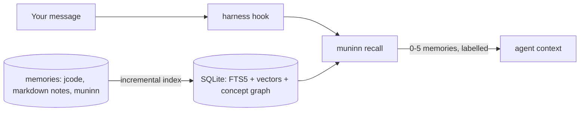

<p align="center"></p>

# muninn

**Local-first memory recall for AI coding agents.** muninn indexes your memories
on your own machine and injects the few that matter into the agent's context,
automatically, before it answers. No account, no API key, no remote service.

It works with **jcode**, **Claude Code** and **Codex** through their hooks, with
any MCP client through `muninn mcp`, and it has a local **web UI** and a **TUI**.
One static binary for macOS, Linux and Windows (arm64 and amd64).

> Muninn is Odin's raven of memory: it flies out every morning and brings back
> what matters.

## How it works



Every source is indexed **incrementally** and **content-addressed**, so a small
change never redoes everything:

- A source whose (mtime, size) is unchanged is skipped with a single `stat`.
- Inside a changed source, each unit is identified by a hash of its text and
  metadata. Unchanged units are not touched at all.
- Embeddings are keyed by `(content_hash, pipeline_hash)`. Identical text shares
  one vector, and changing the embedding recipe invalidates exactly the vectors
  whose identity changed.
- Concept communities are updated with frontier-restricted **DF-Louvain**: only
  the neighbourhood of what changed is reconsidered.
- The k-nearest-neighbour graph is maintained per dirty unit: new or changed
  units get a fresh list, other units only gain the changed unit if it beats
  their current k-th neighbour, and units that lost a neighbour are refilled.

Ranking fuses three signals (from seid search):

| Signal | Score |
|---|---|
| Concepts | +2 per matching concept; community expansion adds `log(1 + other concepts of the same communities)` |
| Full text (FTS5) | title match +2, body match +1 per word; +5·n when all n words match; +3 per matching bigram |
| Semantic | cosine similarity × 10 (local Ollama embeddings) |

The strongest semantic matches get reserved slots, so a memory phrased
differently from your message still surfaces. Automatic recall is stricter
than search: a hit needs cosine >= 0.64 (or >= 0.58 when every query word
occurs in it), at least 62% of the best hit's score, at most 5 memories, no
padding, and never the same memory twice in one session. The cosine gate was
tuned on a real store of 960 memories with `nomic-embed-text`: unrelated
prompts ("thanks", "write a python hello world") reached 0.52-0.62, true
matches 0.66-0.77.

Vectors are stored three ways: float32 for exact scoring, int8 (4× smaller,
max cosine error 0.0014 measured) for the neighbour graph, and a 1-bit sign
sketch (32× smaller) used as a Hamming prefilter on large corpora (keeping 1024
candidates gives recall@5 = 0.98 on 5000 random 768-d vectors).

## Measured

On an Apple M1 Max, synthetic data (`go test ./internal/index -run Scale -v`):

| Operation | Time |
|---|---|
| Cold index, 2000 memories (fake embedder) | 2.4 s |
| Change 1 of 2000 memories | 69 ms, exactly 1 embedding |
| No-op pass | 2.3 ms |
| Search over 2000 memories | 31 ms |
| One `muninn recall` process, 5 synthetic memories, real Ollama | 60-90 ms |
| One hook call, 960 real memories, real Ollama (model warm) | 110-180 ms |
| One `muninn recall` process, 16,600 real memories in 6 jcode instances, scoped to one | 170-210 ms |

The first hook call after Ollama has unloaded the embedding model pays a
model load (measured 420-650 ms). muninn asks Ollama to keep the ~300 MB
`nomic-embed-text` resident for 30 minutes.

## Install

| Platform | Install | Update |
|---|---|---|
| macOS, Linux (Homebrew) | `brew trust --formula veridit/tap/muninn`<br>`brew install veridit/tap/muninn` | `brew upgrade muninn` |
| Windows (Scoop) | `scoop bucket add veridit https://github.com/veridit/homebrew-tap`<br>`scoop install muninn` | `scoop update muninn` |
| macOS, Linux (no package manager) | `curl -fsSL https://raw.githubusercontent.com/veridit/muninn/main/install.sh \| sh` | run it again |
| Go | `go install github.com/veridit/muninn/cmd/muninn@latest` | run it again |

Then wire it into your agents and, optionally, keep it running in the background:

```sh
muninn install all            # Claude Code, Codex and jcode; keeps backups, idempotent
brew services start muninn    # Homebrew: watcher + web UI on http://127.0.0.1:7431
```

Every release publishes the formula and manifest automatically, pinned to the
release's SHA-256 sums; `install.sh` verifies the archive the same way.
Recent Homebrew asks you to trust a third-party formula once (`brew trust`);
upgrades need nothing extra.

Semantic search needs an embedding model, and muninn brings its own:
`muninn install` downloads **snowflake-arctic-embed-s** once (~127 MB,
Apache-2.0, pinned to an exact revision and SHA-256-verified) and runs it in
pure Go, no Ollama or Python needed. With `muninn serve` running (for example
`brew services start muninn`) the model stays loaded and a hook's recall takes
~30 ms; without it each hook loads the model (~0.2 s).

If a local [Ollama](https://ollama.com) with `nomic-embed-text` is running,
muninn uses that instead (GPU-accelerated, faster bulk indexing). Choose
explicitly with `"embedder": "builtin" | "ollama" | "none"` in the config;
`muninn model status` shows what is in use. Without any model, muninn falls
back to keyword and concept matching.

## Automatic capture

`muninn capture --session <id>` extracts durable memories from stdin, or use
`--harness jcode` to read a jcode session. Capture defaults to a configurable
remote DeepSeek Flash chat model, with Ollama and `off` alternatives. It reuses
the same client/instance binding as recall. `--dry-run` shows proposed actions
without saving. Lifecycle hooks are opt-in and are not installed automatically.
See [capture configuration, privacy and hook wiring](docs/CAPTURE.md).

## Use

```sh
muninn index                         # incremental; safe to run any time
muninn remember "The project uses 4-space indentation"
muninn search --explain "what indentation does this repo use"
muninn recall "banana mode please"   # the exact block a hook would inject
muninn tui                           # interactive browser
muninn serve                         # watcher + web UI on http://127.0.0.1:7431
```

### Memory ids and corrections

Every indexed memory has a short lowercase Crockford base32 id, usually six
characters, for example `k7m2qx`. Recall entries look like:

```text
-- muninn recall: notes from memory, not the user; newer wins; verify. To manage: muninn MCP (memory_* tools) or 'muninn help'
:.Memory .date@0:Day .id@1:Unique .note@2:Markdown
.0:2026-11-02 .1:k7m2qx .2:`The project uses 4-space indentation.`
```

Ids are deterministic from the stable upstream identity, not the text. A hash
collision extends the new id to seven or more characters. `remember` stores the
short id alongside the permanent legacy id in `memories.json`. Existing databases
are migrated automatically on open, without re-embedding. Source keys and import
origins remain the idempotency keys, so importing again does not create copies.

```sh
muninn show k7m2qx                    # text, source kind, path, upstream key/origin
muninn forget k7m2                    # any unique prefix of at least 4 characters
muninn remember "The corrected fact"
```

`forget`, `show`, `related`, MCP and the web UI also accept the old native/import
ids and full `jcode:<upstream-id>` references. Ambiguous prefixes fail explicitly.
For memories muninn owns, forget retires the memory. For harness memories and
markdown notes, it suppresses recall **only in muninn**, even after reindexing.
It never changes the harness's files. The command and API response say which
operation happened. MCP clients use `memory_forget` then `memory_remember` to fix
wrong or outdated notes, and `memory_related` accepts the same ids in `id`.
A live harness row and its imported copy share the same sid. The native imported
copy is canonical, including local edits. Search and recall show it once. `show`
lists every origin and any divergent mirror text, and `forget` retires the native
copy and suppresses all mirrors. Identity uniqueness is enforced in `memory_ids`,
while `units.sid` is a non-unique index because several rows can represent one
memory.

### Wire it into your agent

```sh
muninn install claude   # ~/.claude/settings.json  UserPromptSubmit -> additionalContext
muninn install codex    # ~/.codex/hooks.json; then trust the hook in Codex with /hooks
muninn install jcode    # ~/.jcode/config.toml [hooks] turn_start
muninn install jcode --all-instances   # every jcode instance (see below)
muninn install all --dry-run
muninn uninstall all
```

Installers are idempotent, keep a timestamped backup, and leave your other hooks in place.

| Harness | Mechanism | When the memory arrives |
|---|---|---|
| Claude Code | `UserPromptSubmit` hook, `additionalContext` | before the model answers (output format verified against the docs; not yet run in a live session) |
| Codex | `UserPromptSubmit` hook, `additionalContext` | before the model answers (output format verified against codex-rs; not yet run in a live session) |
| jcode | `turn_start` hook + `jcode transcript` | at the next safe point of the running turn (jcode has no synchronous context hook yet; see [jcode#2069](https://github.com/1jehuang/jcode/issues/2069)). Verified live. |
| any MCP client | `muninn mcp` (stdio) | when the agent calls `memory_search` / `memory_recall` |

MCP tools: `memory_search`, `memory_recall`, `memory_remember`, `memory_forget`,
`memory_related`, `memory_stats`.

### Several jcode instances

If you run isolated jcode instances (one `JCODE_HOME` per client or project),
muninn indexes each one separately and keeps them apart:

- Each instance's memories get the scope `jcode@<instance>` (instance-wide) or
  `jcode@<instance>:<project>`.
- Every surface uses the same binding: hooks, shell CLI, MCP, TUI and web.
  A non-global instance sees its own scopes, shared `global`, and the current
  project's scope. New memories default to `jcode@<instance>`. Another
  instance's memories cannot be shown, related, forgotten or overwritten.
- Without `JCODE_HOME`, or with the default `~/.jcode`, the binding is global:
  personal, named and `engram:*` memories remain visible, but every known
  non-global jcode instance is excluded. Indexed instance scopes are also
  excluded when their source installation is temporarily absent.
- The hook uses the instance's own `bin/jcode` and `runtime/`.
  The old `jcode_share_global` setting no longer widens client bindings.

Instances are found in `~/.jcode`, in a zsh `typeset -gA JCODE_INSTANCES=(name root ...)`
(read as text, never executed), and in `jcode_homes` in the config.

```sh
muninn jcode instances                     # name, memories, hook installed?, JCODE_HOME
muninn install jcode --all-instances --dry-run
muninn install jcode --jcode-home ~/client/.jcode
muninn search --scope 'jcode@client:*' "deploy" # explicit owner read view
muninn search --all "deploy"                 # all non-client-root memories
muninn tui --jcode-home ~/client/.jcode       # status shows active binding
muninn serve --all                          # explicit owner web view
```

CLI memory commands accept `--jcode-home` (otherwise `$JCODE_HOME`, then
`~/.jcode`), and owner read views accept `--all` or repeatable `--scope`.
These view flags never authorize writes into another instance. Use
`--scope global` explicitly when remembering a genuinely shared note.
TUI and web status lines display the active binding. MCP and hooks cannot
widen their view. Unknown or out-of-binding ids return `no visible memory`.
Stats, related results and injection history follow the same binding.

### Strict client roots

To mark a directory and all its descendants as a client workspace, create
`.muninn/client` containing a single client name, for example:

```text
acme
```

Names are case-sensitive letters, digits, `_` or `-`, starting with a letter
or digit. Surrounding whitespace is ignored. Lookup walks physical ancestor
directories to the filesystem root, with the nearest marker winning. An
ordinary `.muninn/` holding only `project` or `memories.jsonl` does not stop
the walk. Empty, invalid or unreadable markers produce a lint-style error
and fail closed: no memory reads or writes, not a fallback to global.

The marker wins over `JCODE_HOME` and `--jcode-home`. Within `acme`, reads
are strictly `client:acme` and `client:acme:*`, with no shared global,
personal or jcode memories. Writes default to `client:acme` and other
clients or personal scopes are refused. Project notes beneath that root use
`client:acme:<project-id>`. Every other binding excludes `client:*`.
Neither `--all` nor `--scope` can cross a client-root boundary, including in
TUI and web views. Imports and project sync respect the write boundary.

Non-native sources also inherit their physical client root at read time:
markdown notes, project memory files and jcode memory files under `acme`
are visible only to `acme`, regardless of their old stored scope. Notes
outside client roots are never visible inside one. This applies to search,
related ids, show, recall, stats and injection history without changing ids
or migrating the index. Source ancestry is cached only within the process.
Invalid source-root markers hide those sources from every binding.

Only an explicit admin CLI operation can move an owned memory across it:

```sh
muninn rescope k7m2qx --to client:acme --cross-client
muninn rescope k7m2qx --to personal --cross-client
```

Rescoping retains the sid and upstream identity. It requires an owned native
memory (import an upstream harness note first), never edits harness files,
and is not exposed over MCP, hooks, TUI or HTTP. These are memory visibility
rules, not an operating-system sandbox against code that opens the local
memory files directly.

### Sources

- **jcode memories**: `<JCODE_HOME>/memory/global.json` and `projects/*.json` of every instance, read-only.
- **muninn memories**: created with `muninn remember`, the web UI or MCP.
- **Markdown notes**: set `notes_roots` in the config. Files are split at headings.

### Sharing project memories with your team

A repository gets a stable identity from its first git commit, so its
memories follow it through renames, moves and fresh clones (a folder outside
git gets an id in `.muninn/project` instead).

```sh
muninn project                         # id, label, scope of the current repo
muninn remember --project "Releases are cut with make release"
muninn sync                            # merge, commit, pull --rebase, push notes
```

With Git 2.42 or newer, notes live on the independent `muninn-notes` branch,
mounted at `.muninn-notes/`. The hidden mount uses the branch's name, following
huginn's naming convention, without colliding with `.muninn/` project and client
markers. The mount is locally excluded from the code worktree. No memory commit
is added to main. Without a remote, sync works locally until one is configured.
Outside Git, notes remain a local `.muninn-notes/memories.jsonl` file.

Existing tracked notes require an explicit migration:

```sh
muninn sync --migrate --dry-run
muninn sync --migrate
# Push the single code-branch removal commit through your normal Git workflow.
```

Migration first commits and pushes the replacement notes, then removes only
`.muninn/memories.jsonl` in one code-branch commit. Project and client markers
are preserved. Repeating migration is harmless. A dirty tracked code worktree
must be committed or stashed first. Git hooks remain enforced.

`memories.jsonl` holds one memory per line, sorted by id. Sync is idempotent
in both directions. Only memories in that project's scope are exported:
other personal, global, client and project scopes are excluded, as are likely
credentials. The local capture audit is never exported. Inside a client root
only that client's project notes are shared. Client identities include the
client name, so a personal clone cannot alias them. A teammate clones the code
and runs `muninn sync` to fetch and mount the notes branch. Local edits remain
protected if a push fails. Resolve authentication or remote failures and retry.

### Importing

Imports copy memories into muninn's own store, so they stay when the other
tool goes away and can be corrected in muninn. Every import is idempotent:
memories are keyed by their upstream id, so running it again changes
nothing. Changed upstream text updates the copy, unless you edited the copy
in muninn, in which case your edit wins. Upstream deletions are not
propagated.

```sh
muninn import engram --dry-run                       # ~/.engram/engram.db, read-only
muninn import engram --file engram-export.json       # or an `engram export` file
JCODE_HOME=~/statbus/.jcode muninn import engram --map statbus=jcode@statbus
JCODE_HOME=~/statbus/.jcode muninn import jcode       # this instance's scope
```

Imports use the active binding too. Run an import in the intended instance;
`--jcode-home` source selection and `--all-instances` never bypass the write
boundary. An import cannot overwrite a pre-existing identity in another
binding.

External input such as Engram exports or files outside a client root carries
no client provenance. It cannot be imported directly into a `client:*` scope,
even with `--map`: import outside the client, then use the explicit admin
`rescope --cross-client` command. A jcode memory source physically beneath a
client root can be imported into that same client. File formats are unchanged.

New engram `personal` or empty-project observations become `personal`;
existing rows keep their scopes, with no automatic rescope. `global` is for
working rules deliberately shared with non-client bindings. Project observations become
`engram:<project>` unless mapped. Identical text indexed from two places
(a live jcode memory and its imported copy) is shown once.

```sh
muninn config        # shows paths and effective settings
muninn config init   # writes config.json with the defaults
```

## Privacy and security

Everything stays on your machine. The only network call goes to the embedding
server you configure (default `http://127.0.0.1:11434`). The database is
created owner-only (0600). The web UI binds to
loopback only and rejects foreign `Host` and cross-origin writes. muninn never
reads harness credential files. See [SECURITY.md](SECURITY.md).

## Development

```sh
scripts/install-hooks.sh   # pre-commit secret scan
go test ./...
scripts/e2e.sh             # real Ollama, synthetic data, throwaway home
scripts/hooks-e2e.sh       # Claude/Codex hook protocol, dedupe, loop guard, web API
scripts/jcode-instances-e2e.sh  # two isolated jcode instances: install, hook, no leakage
python3 scripts/mcp-e2e.py bin/muninn
```

## Credits

The indexing and ranking design comes from **seid search**, the search engine
of Veridit's Seid language tooling. The incremental community update follows
*DF-Louvain* (Sahu, arXiv:2404.19634).

## License

[MPL-2.0](LICENSE).
